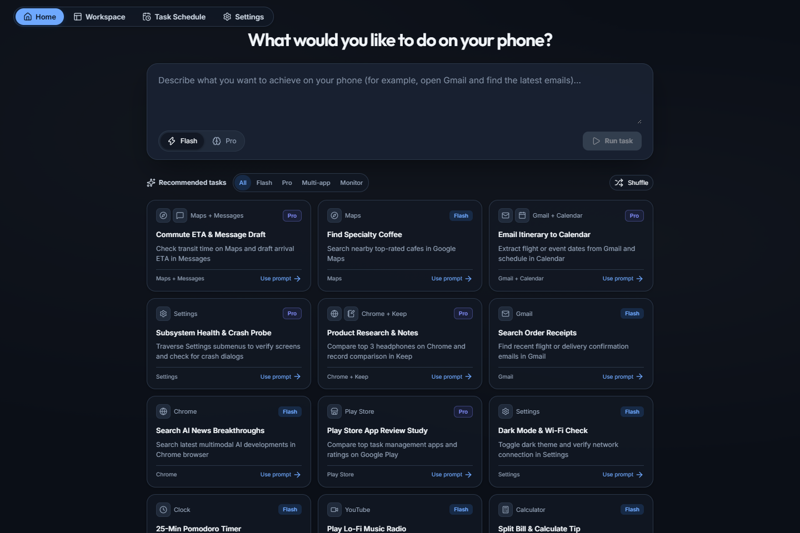
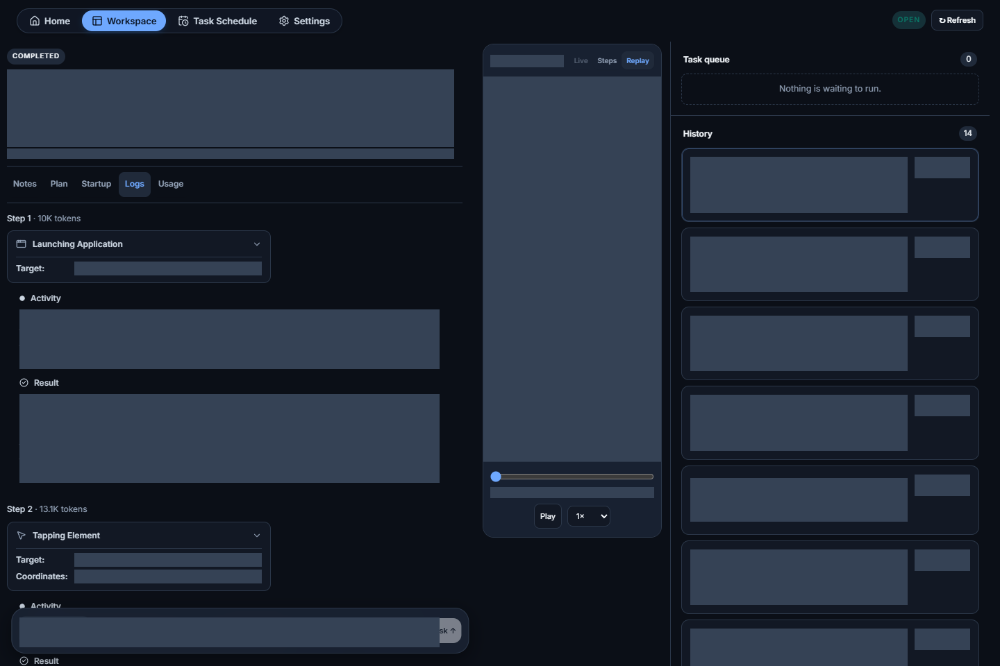
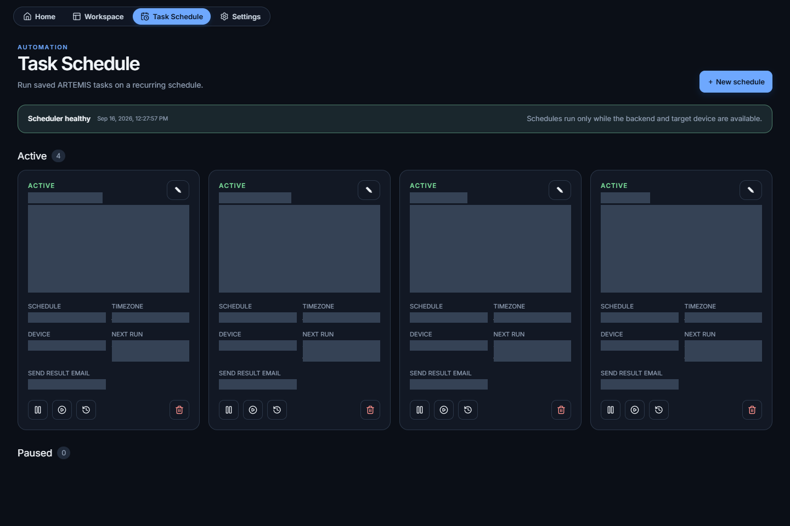
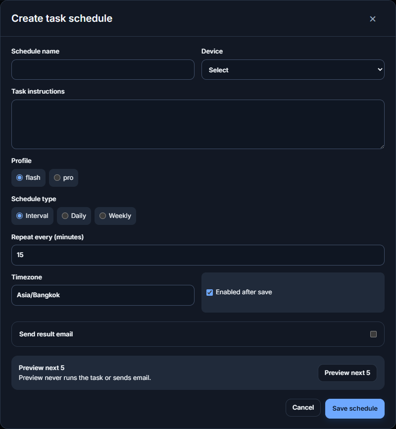
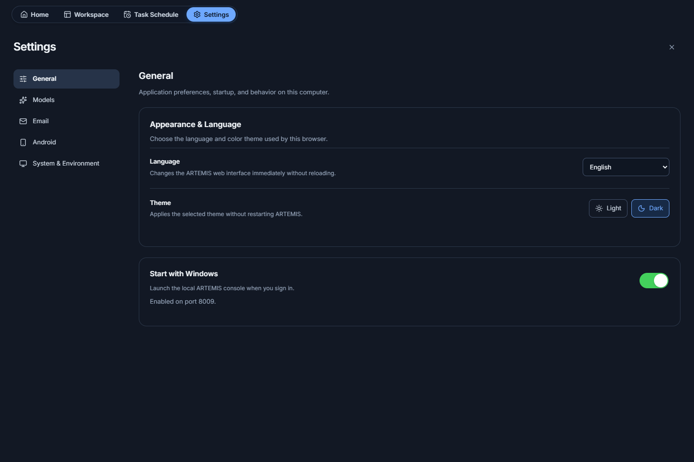

# Android Automation Studio

**AI-powered Android automation with a local web workspace.**

**English** · [Tiếng Việt](README_VI.md)

## Introduction

Android Automation Studio is an independently maintained derivative **cloned from [Google's ARTEMIS project](https://github.com/google/artemis)**. Credit for the original ARTEMIS code and architecture belongs to Google and the upstream contributors. This repository is not an official Google release and does not claim Google endorsement.

Describe a task in natural language, run it on an authorized Android phone or emulator, and follow its execution in the browser. The Python/FastAPI backend runs the automation; the **Next.js/TypeScript frontend with shadcn/ui** provides the interface. Angular has been removed.

- **This repository:** [jokerhung/android-automation-studio](https://github.com/jokerhung/android-automation-studio)
- **Original project:** [google/artemis](https://github.com/google/artemis)
- **License:** [Apache 2.0](LICENSE), with upstream notices retained. Inherited code also includes contributions from [Minitap, Inc.](https://github.com/minitap-ai/mobile-use); third-party components retain their own licenses.

Use only devices and accounts you are authorized to control. Tasks may change application data, and configured AI providers may receive task text and device observations. Review instructions before running them.

## Build and run

### Prerequisites

- Git.
- Python **3.12+**, managed through [uv](https://docs.astral.sh/uv/).
- Node.js **20.9+** and npm for building the frontend; the repository CI uses Node **22.22.3**.
- An Android phone with **USB debugging enabled and authorized**, or a running Android emulator.
- ADB for device connectivity; scrcpy/FFmpeg for recording-related capabilities.
- Credentials for the AI provider you intend to use.
- Internet access for initial dependency installation and cloud AI requests.

The startup scripts try to discover or install missing tools, initialize `.env` if absent, synchronize Python dependencies, and build the frontend when necessary. Installation can require permission or fail on an unsupported environment. Review prompts, including the optional IDE/MCP installation.

### Windows — PowerShell

**Quick start:**

```powershell
git clone https://github.com/jokerhung/android-automation-studio.git
cd android-automation-studio
.\start.bat
```

**Explicit build and run** — after installing the prerequisites:

```powershell
if (-not (Test-Path .env)) { Copy-Item .env.example .env }
uv sync --locked
npm.cmd ci --prefix apps/showcase_next
npm.cmd run build --prefix apps/showcase_next
uv run python -m artemis ui --port 8009 --open
```

To use another port or skip opening a browser:

```powershell
.\start.bat -Port 8010 -NoOpen
```

### macOS

Install the prerequisites, connect an authorized device, then:

```bash
git clone https://github.com/jokerhung/android-automation-studio.git
cd android-automation-studio
bash start.sh
```

For an explicit build and run:

```bash
[ -f .env ] || cp .env.example .env
uv sync --locked
npm ci --prefix apps/showcase_next
npm run build --prefix apps/showcase_next
uv run python -m artemis ui --port 8009 --open
```

macOS setup can use Homebrew if available. Windows sign-in startup/tray and Windows DPAPI email credential storage do not apply to macOS.

### Linux

Install the prerequisites, ensure your user has permission to access the Android USB device, then:

```bash
git clone https://github.com/jokerhung/android-automation-studio.git
cd android-automation-studio
bash start.sh
```

For an explicit build and run:

```bash
[ -f .env ] || cp .env.example .env
uv sync --locked
npm ci --prefix apps/showcase_next
npm run build --prefix apps/showcase_next
uv run python -m artemis ui --port 8009 --open
```

Linux setup can use the available package manager or supported user-space fallbacks. USB permissions/udev configuration may need manual setup. For a headless session or a different port:

```bash
bash start.sh --port 8010 --no-open
```

### Open the application and configure it

The startup scripts default to **[http://localhost:8009/](http://localhost:8009/)**. Direct CLI lifecycle commands may have a different default, so specify `--port 8009` explicitly.

1. Open **Settings → Models** and set the provider, default/fallback models, API key and optional custom URL. Follow the confirmation before saving/restarting the service.
2. Open **Settings → Android** and verify the device connection.
3. Check prerequisites in **System & Environment**.
4. Return to **Home**, enter a task, and select **Flash** or **Pro**.

Do not overwrite an existing `.env` when upgrading. Never commit credentials or include real passwords in screenshots or public issues.

The production frontend is a **static export** in `apps/showcase_next/out`, served by FastAPI on the same origin as the API. It does not require a separate Next.js/Node server. Rebuild after frontend changes, then hard-refresh the browser.

### Build packages and run checks

From the repository root, after building the frontend:

```bash
uv build --package artemis-client --wheel
uv build --package artemis --wheel --sdist
```

Artifacts are written to `dist/`. The ARTEMIS package includes the built frontend; these are Python distributions, not native desktop installers.

```bash
npm run lint --prefix apps/showcase_next
npm run typecheck --prefix apps/showcase_next
npm test --prefix apps/showcase_next
npm run budget:check --prefix apps/showcase_next
```

See [Next.js-only deployment notes](docs/nextjs-only-cutover.md) for packaging details. The commands describe the platform-specific workflows; they are not a claim that every OS/device combination has been validated.

## Basic features and screenshots

The following screenshots were captured from the running application at **http://localhost:8009/** on **2026-09-16**, using English and the dark theme. Solid gray areas intentionally hide real task, account and device information; they are not loading placeholders. No task was run and no backend setting was changed to produce these screenshots.

### Home — launch a task

Enter a natural-language goal or choose a suggested task.

- **Flash:** reactive execution for straightforward app interactions.
- **Pro:** planning and verification for more complex workflows, with expected output and tuning controls.
- Prerequisite checks prevent launching when the required environment is not ready.



### Workspace — follow execution and replay

The three-column workspace keeps activity, device media and task history together.

- **Left:** readable action cards, activity/results, notes, plan and usage. During execution, Logs follow new content while the header and tabs remain fixed.
- **Center:** live device view, recorded steps or video replay, with a time slider and playback speed.
- **Right:** active task queue and previous sessions.
- Stop/resume controls are available when the selected task state allows them.

The screenshot below shows a completed session; its personal content and device recording are redacted.



### Task Schedule — recurring automation

Create **interval** schedules in minutes, **daily** schedules, or **weekly** schedules with selected weekdays. Configure time down to seconds and choose a timezone.

- Preview the next five occurrences before saving.
- Pause/resume a schedule, run it now, inspect history, or delete it using compact icon buttons.
- Long task descriptions scroll inside fixed-height areas.
- Where SMTP is configured and supported, send the task summary with a text execution-log attachment.

Schedules require the host computer and ARTEMIS backend to stay running, and the target device must be available. Scheduling does not wake or power on the computer.



<details>
<summary>Create a new schedule</summary>

The form below was opened without saving or running a task.



</details>

### Settings — appearance, models and devices

- **General:** English/Vietnamese language, light/dark themes, and Start with Windows on supported installations.
- **Models:** provider, default/fallback model, credentials and custom API URL; save/restart confirmation.
- **Email:** SMTP connection settings and explicit connection/test-email actions.
- **Android:** local/remote ADB, device selection and installed emulator controls.
- **System & Environment:** dependency checks and readiness information.



### Platform-specific features

| Feature | Windows | macOS / Linux |
| --- | --- | --- |
| Next.js Web UI and Python backend | Available | Available; local tool/device setup required |
| Task schedules | Backend must remain running | Backend must remain running |
| Start with Windows and Windows system tray | Supported Windows integration | Not applicable |
| SMTP password storage | Windows DPAPI | Not implemented by the current secret-store backend |

Do not assume email notifications are available on macOS/Linux merely because the Email tab is visible.

### IDE integration

The inherited ARTEMIS MCP server can connect automation capabilities to compatible AI assistants. The startup script offers optional installation; use it only if you want to change your IDE configuration. This integration is separate from using the Web UI.

For implementation details, explore [docs](docs/). Report issues for this derivative at [the repository issue tracker](https://github.com/jokerhung/android-automation-studio/issues), with secrets removed from logs and screenshots.
