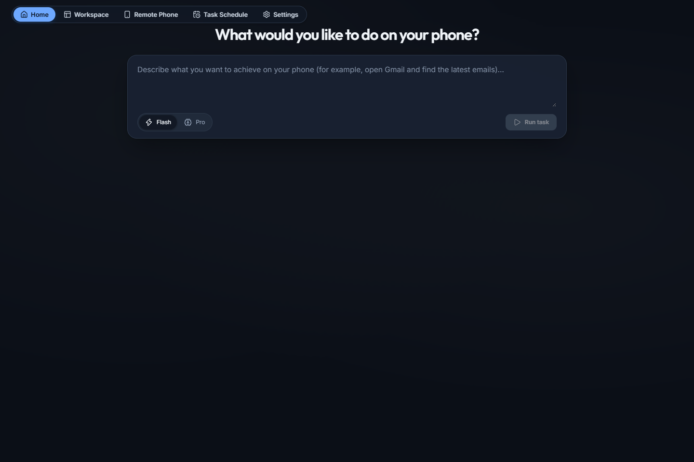
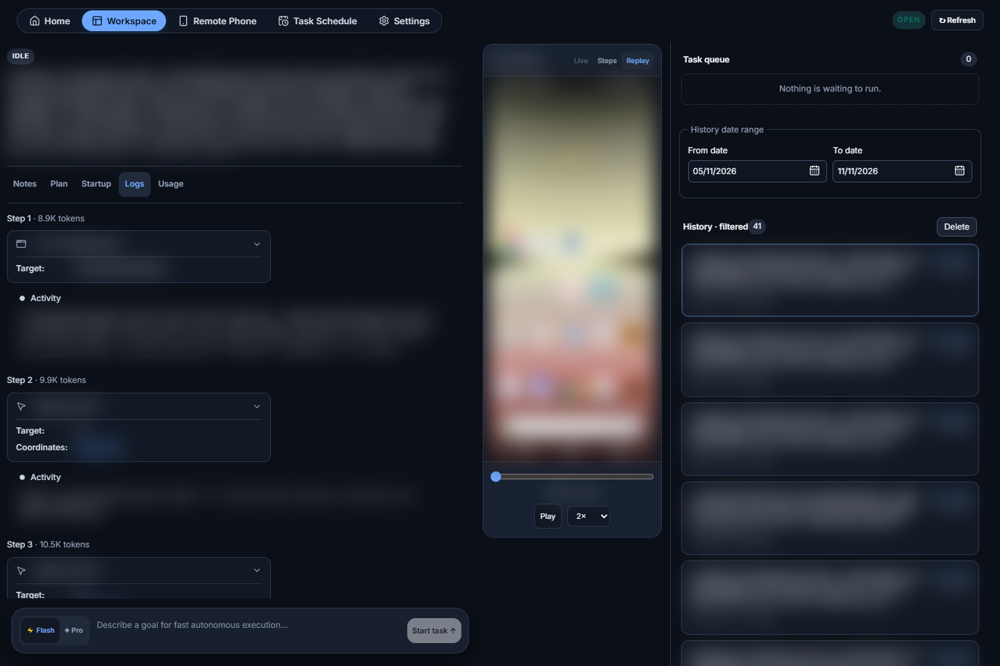
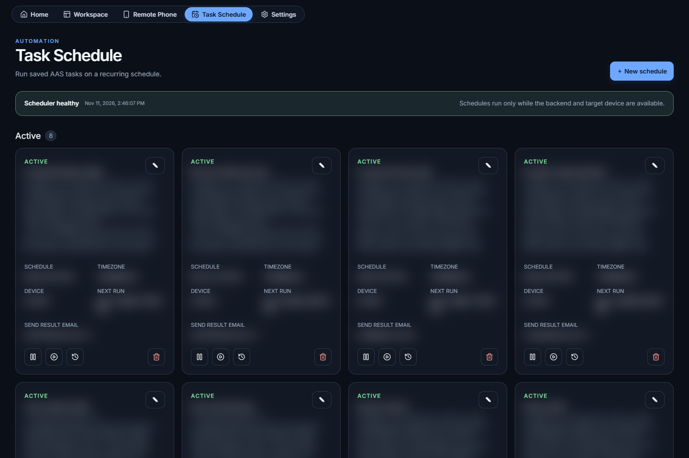
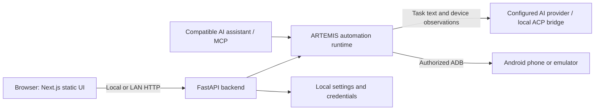

# Android Automation Studio

Android Automation Studio uses AI to automate tasks on Android phones and emulators. Describe what you want to do in natural language, then follow the execution through a web interface. Schedule recurring tasks and review results with logs and recordings.

**English** · [Tiếng Việt](README_VI.md)







---

## ⚡ Quick Start

Run the command for your operating system:

**Windows (PowerShell):**

```powershell
irm https://raw.githubusercontent.com/jokerhung/android-automation-studio/nextjs/install.ps1 | iex
```

**Linux / macOS (Bash):**

```bash
curl -fsSL https://raw.githubusercontent.com/jokerhung/android-automation-studio/nextjs/install.sh | bash
```

Then open **[http://localhost:8009/](http://localhost:8009/)** or the URL printed by the installer.

See [installation details and release status](docs/installation.md).

---

## ✨ 8 Superpowers

- 🤖 **Natural-language Android automation** — describe a goal and execute it on an authorized phone or emulator.
- ⚡ **Flash and Pro modes** — reactive execution for simple tasks, or planning and verification for complex workflows.
- 🖥️ **Live execution workspace** — action cards, logs, plans, notes, usage and task history in one view.
- 🎬 **Recording and replay** — review device media, recorded steps and video with timeline and speed controls.
- 📅 **Recurring task schedules** — interval, daily and weekly runs with timezone selection, previews and history.
- 🧠 **Configurable AI providers** — choose default/fallback models, API keys or the local OpenAI ACP bridge described below.
- 📱 **Android device tools** — local/remote ADB, emulator controls and a Remote Phone page for ordinary UI input.
- 🔌 **MCP integration** — expose automation capabilities to compatible AI assistants through the inherited ARTEMIS MCP server.

---

## 🛡️ Security Architecture



---

## 📂 Project Structure (Monorepo)

| Path | Purpose |
| --- | --- |
| `artemis/` | Python automation runtime, agents, device drivers, services and CLI |
| `apps/admin_console/` | FastAPI web/API server and administration routes |
| `apps/showcase_next/` | Next.js / TypeScript web interface with shadcn/ui; static export in `out/` |
| `packages/artemis-client/` | Python client SDK, managed as a uv workspace package |
| `mcp_server/` | MCP server integration for compatible AI assistants |
| `scripts/` | Bootstrap, build, lifecycle and verification helpers |
| `config/` | Configuration resources |
| `docs/` | Installation guides, deployment notes and screenshots |
| `tests/` | Automated checks for the backend and integrations |
| `playground/` | Container and backend experiments |

### Development Setup

#### Prerequisites

- Git.
- Python **3.12+**, managed through [uv](https://docs.astral.sh/uv/).
- Node.js **20.9+** and npm for building the frontend; the repository CI uses Node **22.22.3**.
- An Android phone with **USB debugging enabled and authorized**, or a running Android emulator.
- ADB for device connectivity; scrcpy/FFmpeg for recording-related capabilities.
- Credentials for the AI provider you intend to use.
- Internet access for initial dependency installation and cloud AI requests.

The startup scripts try to discover or install missing tools, initialize `.env` if absent, synchronize Python dependencies, and build the frontend when necessary. Installation can require permission or fail on an unsupported environment. Review prompts, including the optional IDE/MCP installation.

#### Windows — PowerShell

**Quick start:**

```powershell
git clone https://github.com/jokerhung/android-automation-studio.git
cd android-automation-studio
.\start.bat
```

**Explicit build and run** — after installing the prerequisites:

```powershell
if (-not (Test-Path .env)) { Copy-Item .env.example .env }
uv sync --locked
npm.cmd ci --prefix apps/showcase_next
npm.cmd run build --prefix apps/showcase_next
uv run python -m artemis ui --port 8009 --open
```

To use another port or skip opening a browser:

```powershell
.\start.bat -Port 8010 -NoOpen
```

**Run as a background daemon, or stop it** — `start.bat` forwards its arguments to `scripts/start.ps1`, which can also launch the server detached from the console (via `artemis restart --daemon`) and stop the identity-verified daemon on a port:

```powershell
.\start.bat -Daemon      # build (if stale) + run detached in the background
.\start.bat -Stop        # stop the running server, no build
```

**Rebuild the frontend and restart** — `scripts/rebuild.ps1` always rebuilds the Next.js Showcase UI (unlike `start.bat`, which only rebuilds when sources changed) and then restarts the unified API + GUI server:

```powershell
.\scripts\rebuild.ps1            # rebuild + run in this console (foreground)
.\scripts\rebuild.ps1 -Daemon    # rebuild + run detached in the background
.\scripts\rebuild.ps1 -Stop      # stop the server, no rebuild
.\scripts\rebuild.ps1 -Port 8010 -NoOpen
```

Both scripts stop and start the server through Artemis's own identity-verified lifecycle commands (`artemis ui --restart`, `artemis restart --daemon`, `artemis stop`), never by killing a PID found on the port directly.

#### macOS

Install the prerequisites, connect an authorized device, then:

```bash
git clone https://github.com/jokerhung/android-automation-studio.git
cd android-automation-studio
bash start.sh
```

For an explicit build and run:

```bash
[ -f .env ] || cp .env.example .env
uv sync --locked
npm ci --prefix apps/showcase_next
npm run build --prefix apps/showcase_next
uv run python -m artemis ui --port 8009 --open
```

macOS setup can use Homebrew if available. Windows sign-in startup/tray and Windows DPAPI email credential storage do not apply to macOS.

#### Linux

Install the prerequisites, ensure your user has permission to access the Android USB device, then:

```bash
git clone https://github.com/jokerhung/android-automation-studio.git
cd android-automation-studio
bash start.sh
```

For an explicit build and run:

```bash
[ -f .env ] || cp .env.example .env
uv sync --locked
npm ci --prefix apps/showcase_next
npm run build --prefix apps/showcase_next
uv run python -m artemis ui --port 8009 --open
```

Linux setup can use the available package manager or supported user-space fallbacks. USB permissions/udev configuration may need manual setup. For a headless session or a different port:

```bash
bash start.sh --port 8010 --no-open
```

#### Open the application and configure it

The startup scripts default to **[http://localhost:8009/](http://localhost:8009/)**. Direct CLI lifecycle commands may have a different default, so specify `--port 8009` explicitly.

1. Open **Settings → Models** and set the provider, default/fallback models, API key and optional custom URL. Follow the confirmation before saving/restarting the service.
2. Open **Settings → Android** and verify the device connection.
3. Check prerequisites in **System & Environment**.
4. Return to **Home**, enter a task, and select **Flash** or **Pro**.

Do not overwrite an existing `.env` when upgrading. Never commit credentials or include real passwords in screenshots or public issues.

The production frontend is a **static export** in `apps/showcase_next/out`, served by FastAPI on the same origin as the API. It does not require a separate Next.js/Node server. Rebuild after frontend changes, then hard-refresh the browser.

#### Build packages and run checks

From the repository root, after building the frontend:

```bash
uv build --package artemis-client --wheel
uv build --package artemis --wheel --sdist
```

Artifacts are written to `dist/`. The ARTEMIS package includes the built frontend; these are Python distributions, not native desktop installers.

```bash
npm run lint --prefix apps/showcase_next
npm run typecheck --prefix apps/showcase_next
npm test --prefix apps/showcase_next
npm run budget:check --prefix apps/showcase_next
```

See [Next.js-only deployment notes](docs/nextjs-only-cutover.md) for packaging details. The commands describe the platform-specific workflows; they are not a claim that every OS/device combination has been validated.

---

## 📄 License

[Apache License 2.0](LICENSE). Free to use, modify and distribute, including commercially, subject to the license terms.

Android Automation Studio is an independently maintained derivative **cloned from [Google's ARTEMIS project](https://github.com/google/artemis)**. Credit for the original ARTEMIS code and architecture belongs to Google and the upstream contributors. This repository is not an official Google release and does not claim Google endorsement.

- **This repository:** [jokerhung/android-automation-studio](https://github.com/jokerhung/android-automation-studio)
- **Original project:** [google/artemis](https://github.com/google/artemis)
- **License:** [Apache 2.0](LICENSE), with upstream notices retained. Inherited code also includes contributions from [Minitap, Inc.](https://github.com/minitap-ai/mobile-use); third-party components retain their own licenses.
