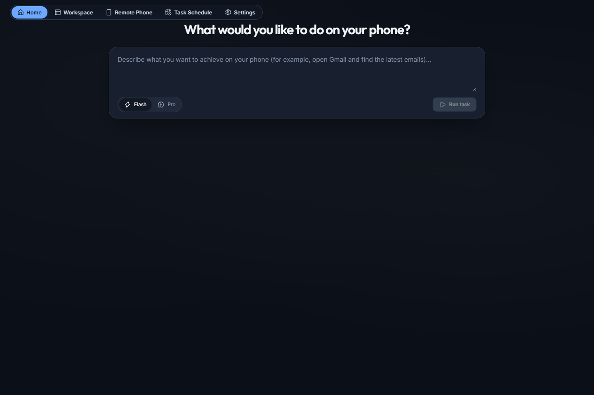
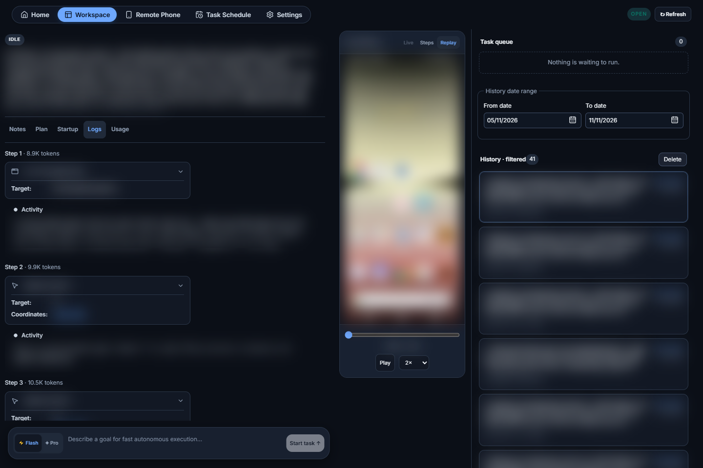
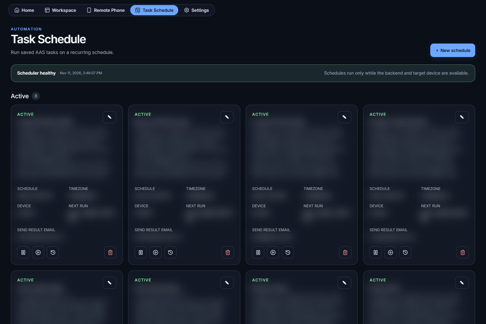
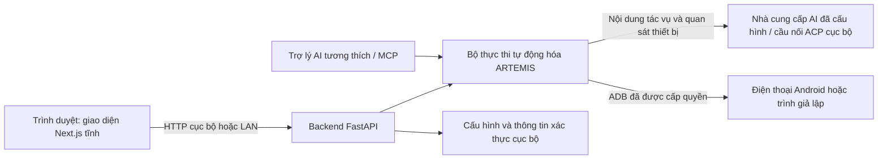

# Android Automation Studio

Android Automation Studio sử dụng AI để tự động hóa tác vụ trên điện thoại Android và trình giả lập. Mô tả việc bạn muốn làm bằng ngôn ngữ tự nhiên, rồi theo dõi quá trình thực hiện qua giao diện web. Lên lịch tác vụ định kỳ và xem lại kết quả qua nhật ký cùng bản ghi màn hình.

[English](README.md) · **Tiếng Việt**







---

## ⚡ Bắt đầu nhanh

Chạy lệnh phù hợp với hệ điều hành của bạn:

**Windows (PowerShell):**

```powershell
irm https://raw.githubusercontent.com/jokerhung/android-automation-studio/nextjs/install.ps1 | iex
```

**Linux / macOS (Bash):**

```bash
curl -fsSL https://raw.githubusercontent.com/jokerhung/android-automation-studio/nextjs/install.sh | bash
```

Sau đó mở **[http://localhost:8009/](http://localhost:8009/)** hoặc URL mà trình cài đặt hiển thị.

Xem [chi tiết cài đặt và tình trạng phát hành](docs/installation.md).

---

## ✨ 8 tính năng nổi bật

- 🤖 **Tự động hóa Android bằng ngôn ngữ tự nhiên** — mô tả mục tiêu và thực hiện trên điện thoại hoặc trình giả lập đã được cấp quyền.
- ⚡ **Chế độ Flash và Pro** — thực hiện trực tiếp các tác vụ đơn giản, hoặc lập kế hoạch và kiểm chứng cho quy trình phức tạp.
- 🖥️ **Theo dõi thực thi trực tiếp** — xem các thẻ hành động, nhật ký, kế hoạch, ghi chú, mức sử dụng và lịch sử tác vụ trong cùng một giao diện.
- 🎬 **Ghi hình và phát lại** — xem lại hình ảnh thiết bị, các bước đã ghi và video với thanh thời gian cùng tùy chỉnh tốc độ.
- 📅 **Lịch tác vụ định kỳ** — chạy theo khoảng thời gian, hằng ngày hoặc hằng tuần, với lựa chọn múi giờ, xem trước và lịch sử.
- 🧠 **Tùy chỉnh nhà cung cấp AI** — chọn mô hình mặc định/dự phòng, khóa API hoặc cầu nối OpenAI ACP cục bộ.
- 📱 **Công cụ thiết bị Android** — ADB cục bộ/từ xa, điều khiển trình giả lập và trang Remote Phone để thao tác giao diện thông thường.
- 🔌 **Tích hợp MCP** — cung cấp khả năng tự động hóa cho các trợ lý AI tương thích thông qua máy chủ MCP kế thừa từ ARTEMIS.

---

## 🛡️ Kiến trúc bảo mật



---

## 📂 Cấu trúc dự án (Monorepo)

| Đường dẫn | Chức năng |
| --- | --- |
| `artemis/` | Bộ thực thi tự động hóa Python, các agent, trình điều khiển thiết bị, dịch vụ và CLI |
| `apps/admin_console/` | Máy chủ web/API FastAPI và các tuyến quản trị |
| `apps/showcase_next/` | Giao diện web Next.js / TypeScript với shadcn/ui; bản xuất tĩnh trong `out/` |
| `packages/artemis-client/` | SDK Python cho client, được quản lý dưới dạng gói trong uv workspace |
| `mcp_server/` | Tích hợp máy chủ MCP cho các trợ lý AI tương thích |
| `scripts/` | Script khởi tạo, build, quản lý vòng đời và kiểm tra |
| `config/` | Tài nguyên cấu hình |
| `docs/` | Hướng dẫn cài đặt, ghi chú triển khai và ảnh chụp màn hình |
| `tests/` | Kiểm tra tự động cho backend và các tích hợp |
| `playground/` | Thử nghiệm container và backend |

### Thiết lập môi trường phát triển

#### Yêu cầu

- Git.
- Python **3.12+**, quản lý bằng [uv](https://docs.astral.sh/uv/).
- Node.js **20.9+** và npm để build frontend; CI của repository sử dụng Node **22.22.3**.
- Điện thoại Android đã **bật USB debugging và cấp quyền kết nối**, hoặc trình giả lập Android đang chạy.
- ADB để kết nối thiết bị; scrcpy/FFmpeg cho các chức năng liên quan đến ghi hình.
- Thông tin xác thực của nhà cung cấp AI bạn muốn sử dụng.
- Kết nối Internet để cài đặt dependency lần đầu và gửi yêu cầu đến AI trên đám mây.

Các script khởi động tìm hoặc thử cài công cụ còn thiếu, tạo `.env` nếu chưa có, đồng bộ dependency Python và build frontend khi cần. Việc cài đặt có thể cần cấp quyền hoặc không thành công trong môi trường chưa hỗ trợ. Đọc các lời nhắc, bao gồm bước cài đặt IDE/MCP tùy chọn.

#### Windows — PowerShell

**Chạy nhanh:**

```powershell
git clone https://github.com/jokerhung/android-automation-studio.git
cd android-automation-studio
.\start.bat
```

**Build và chạy thủ công** — sau khi cài đủ công cụ cần thiết:

```powershell
if (-not (Test-Path .env)) { Copy-Item .env.example .env }
uv sync --locked
npm.cmd ci --prefix apps/showcase_next
npm.cmd run build --prefix apps/showcase_next
uv run python -m artemis ui --port 8009 --open
```

Để dùng cổng khác hoặc không tự mở trình duyệt:

```powershell
.\start.bat -Port 8010 -NoOpen
```

**Chạy nền hoặc dừng máy chủ** — `start.bat` chuyển tiếp tham số đến `scripts/start.ps1`. Script này cũng có thể khởi chạy máy chủ tách khỏi cửa sổ dòng lệnh (qua `artemis restart --daemon`) và dừng daemon trên một cổng sau khi xác minh danh tính:

```powershell
.\start.bat -Daemon      # build nếu đã cũ, sau đó chạy nền
.\start.bat -Stop        # dừng máy chủ đang chạy, không build
```

**Build lại frontend và khởi động lại** — `scripts/rebuild.ps1` luôn build lại giao diện Next.js Showcase (khác với `start.bat`, chỉ build lại khi mã nguồn thay đổi), rồi khởi động lại máy chủ API và giao diện dùng chung:

```powershell
.\scripts\rebuild.ps1            # build lại và chạy trong cửa sổ hiện tại
.\scripts\rebuild.ps1 -Daemon    # build lại và chạy nền
.\scripts\rebuild.ps1 -Stop      # dừng máy chủ, không build lại
.\scripts\rebuild.ps1 -Port 8010 -NoOpen
```

Cả hai script dừng và khởi động máy chủ bằng các lệnh quản lý vòng đời có xác minh danh tính của Artemis (`artemis ui --restart`, `artemis restart --daemon`, `artemis stop`), không dừng trực tiếp một PID chỉ vì tiến trình đó đang giữ cổng.

#### macOS

Cài đủ công cụ cần thiết, kết nối thiết bị đã cấp quyền, rồi chạy:

```bash
git clone https://github.com/jokerhung/android-automation-studio.git
cd android-automation-studio
bash start.sh
```

Để build và chạy thủ công:

```bash
[ -f .env ] || cp .env.example .env
uv sync --locked
npm ci --prefix apps/showcase_next
npm run build --prefix apps/showcase_next
uv run python -m artemis ui --port 8009 --open
```

Quá trình thiết lập trên macOS có thể dùng Homebrew nếu có. Các tính năng khởi động khi đăng nhập Windows, khay hệ thống Windows và lưu thông tin xác thực email bằng Windows DPAPI không áp dụng cho macOS.

#### Linux

Cài đủ công cụ cần thiết, bảo đảm tài khoản của bạn có quyền truy cập thiết bị Android qua USB, rồi chạy:

```bash
git clone https://github.com/jokerhung/android-automation-studio.git
cd android-automation-studio
bash start.sh
```

Để build và chạy thủ công:

```bash
[ -f .env ] || cp .env.example .env
uv sync --locked
npm ci --prefix apps/showcase_next
npm run build --prefix apps/showcase_next
uv run python -m artemis ui --port 8009 --open
```

Thiết lập trên Linux có thể dùng trình quản lý gói sẵn có hoặc phương án cài trong phạm vi người dùng được hỗ trợ. Quyền USB/cấu hình udev có thể cần thiết lập thủ công. Để chạy không mở trình duyệt hoặc dùng cổng khác:

```bash
bash start.sh --port 8010 --no-open
```

#### Mở ứng dụng và cấu hình

Các script khởi động mặc định dùng **[http://localhost:8009/](http://localhost:8009/)**. Các lệnh CLI quản lý vòng đời chạy trực tiếp có thể dùng giá trị mặc định khác, vì vậy hãy chỉ định rõ `--port 8009`.

1. Mở **Settings → Models** và thiết lập nhà cung cấp, mô hình mặc định/dự phòng, khóa API và URL tùy chỉnh nếu cần. Làm theo bước xác nhận trước khi lưu/khởi động lại dịch vụ.
2. Mở **Settings → Android** và kiểm tra kết nối thiết bị.
3. Kiểm tra các yêu cầu trong **System & Environment**.
4. Quay lại **Home**, nhập tác vụ và chọn **Flash** hoặc **Pro**.

Không ghi đè `.env` hiện có khi nâng cấp. Không commit thông tin xác thực hoặc đưa mật khẩu thật vào ảnh chụp màn hình hay issue công khai.

Frontend production là **bản xuất tĩnh** trong `apps/showcase_next/out`, được FastAPI phục vụ cùng nguồn với API. Không cần máy chủ Next.js/Node riêng. Sau khi thay đổi frontend, build lại rồi tải lại trình duyệt và bỏ qua bộ nhớ đệm.

#### Đóng gói và chạy kiểm tra

Từ thư mục gốc của repository, sau khi build frontend:

```bash
uv build --package artemis-client --wheel
uv build --package artemis --wheel --sdist
```

Các gói được ghi vào `dist/`. Gói ARTEMIS bao gồm frontend đã build; đây là các bản phân phối Python, không phải bộ cài ứng dụng desktop gốc.

```bash
npm run lint --prefix apps/showcase_next
npm run typecheck --prefix apps/showcase_next
npm test --prefix apps/showcase_next
npm run budget:check --prefix apps/showcase_next
```

Xem [ghi chú triển khai chỉ dùng Next.js](docs/nextjs-only-cutover.md) để biết chi tiết đóng gói. Các lệnh mô tả quy trình cho từng nền tảng; không có nghĩa là mọi tổ hợp hệ điều hành/thiết bị đã được kiểm chứng.

---

## 📄 Giấy phép

[Apache License 2.0](LICENSE). Được sử dụng, sửa đổi và phân phối tự do, bao gồm mục đích thương mại, theo các điều khoản của giấy phép.

Android Automation Studio là bản tùy chỉnh được duy trì độc lập, **clone từ [dự án ARTEMIS của Google](https://github.com/google/artemis)**. Mã nguồn và kiến trúc ARTEMIS ban đầu thuộc công sức của Google cùng các tác giả đóng góp ở dự án gốc. Repository này không phải bản phát hành chính thức của Google và không tuyên bố được Google bảo trợ.

- **Repository này:** [jokerhung/android-automation-studio](https://github.com/jokerhung/android-automation-studio)
- **Dự án gốc:** [google/artemis](https://github.com/google/artemis)
- **Giấy phép:** [Apache 2.0](LICENSE), giữ nguyên các thông báo từ dự án gốc. Mã nguồn kế thừa cũng bao gồm đóng góp từ [Minitap, Inc.](https://github.com/minitap-ai/mobile-use); các thành phần bên thứ ba giữ giấy phép riêng.
